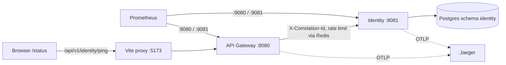

# Slice 1.0 — Platform skeleton

## 1. Objective
A runnable, observable foundation: React shell, API Gateway, shared cross-cutting library, one proof service (identity skeleton), database migrations, local infra, CI. No business features yet.

## 2. Architecture


## 3. Design decisions
- Gateway is reactive (Spring Cloud Gateway) so it cannot reuse servlet code; `arqon-common` serves servlet services only (ADR-0017).
- Deny-by-default security in identity from day one; only `/ping`, health, metrics, API docs are public. JWT/RBAC arrives in 1.1.
- Rate limiting: Redis token bucket per IP at the gateway (20 req/s, burst 40), fails open if Redis is down.
- Gateway strips X-Tenant-Id / X-User-Id / X-User-Roles from clients.
- Flyway owns the schema; Hibernate only validates. Each service gets its own schema; outbox/processed_events tables are in the baseline migration.
- Dev proxy: browser talks to one origin, so no CORS needed locally. Production CORS/CSP decided with the CDN setup (Phase 10).

## 4. Folder structure (what changed)
```
pom.xml                         parent (Spring Boot 3.4.1, Spring Cloud 2024.0.0, Java 21)
shared/common/                  ApiError, ErrorCode, ArqonException, GlobalExceptionHandler, CorrelationIdFilter, TenantContext
services/api-gateway/           routes, correlation filter, IP rate limit, uniform gateway errors
services/identity-service/      ping, deny-by-default security, Flyway V1, Testcontainers IT
frontend/arqon-web/             Vite + React + TS + Tailwind v4 + Router + TanStack Query + Zod; 5 portal placeholders; /status page
infra/docker/                   + Jaeger; infra/monitoring/prometheus.yml scrapes both services
.github/workflows/ci.yml        backend verify + frontend test/build
```
Not yet added (added when first used): React Hook Form, Monaco, Dockerfiles for services, Kubernetes manifests.

## 5. Configuration
Profiles: `local` (default), `test`, `prod` (no secret defaults, ECS JSON logs, 10% trace sampling, Swagger off).
Env vars: REDIS_HOST/PORT/PASSWORD, DB_URL/DB_USERNAME/DB_PASSWORD, IDENTITY_SERVICE_URI, TRUSTED_PROXY_HOPS, OTLP_TRACING_ENDPOINT, TRACING_SAMPLING.

## 6. API (this slice)
| Method | Path | Auth | Notes |
|---|---|---|---|
| GET | /api/v1/identity/ping | public | `{service,status,correlationId,timestamp}` |
| * | anything else on identity | required | 401 `UNAUTHENTICATED` until 1.1 |
Error body: `{timestamp,status,code,message,traceId,details[]}`.

## 7. How to run
```bash
cp infra/docker/.env.example infra/docker/.env
docker compose -f infra/docker/docker-compose.yml --env-file infra/docker/.env up -d

mvn -B install -DskipTests                 # builds common + services (needs JDK 21 + Maven 3.9+)
(cd services/identity-service && mvn spring-boot:run)     # terminal 1  (:8081, mgmt :9081)
(cd services/api-gateway && mvn spring-boot:run)          # terminal 2  (:8080, mgmt :9080)
(cd frontend/arqon-web && npm install && npm run dev)     # terminal 3  (:5173)
```
Tests: `mvn test` (unit, no Docker) · `mvn verify` (adds Testcontainers ITs, needs Docker) · `cd frontend/arqon-web && npm test`.

## 8. Verification checklist
1. `curl -i localhost:8080/api/v1/identity/ping` → 200, `X-Correlation-Id` header, JSON status UP.
2. `curl -i -H 'X-Correlation-Id: my-test-id-123' localhost:8080/api/v1/identity/ping` → same id echoed (once).
3. `curl -i localhost:8080/api/v1/identity/anything` → 401 JSON `UNAUTHENTICATED` with traceId.
4. `curl -i localhost:8080/nope` → 404 JSON `NOT_FOUND` (gateway-level, uniform body).
5. Stop identity, repeat (1) → 5xx JSON `UPSTREAM_UNAVAILABLE`, no hostnames in body.
6. `curl localhost:9081/actuator/health` → UP; `curl localhost:8080/actuator/health` → 404 (not exposed publicly).
7. Rate limit: `for i in $(seq 1 80); do curl -s -o /dev/null -w "%{http_code}\n" localhost:8080/api/v1/identity/ping; done | sort | uniq -c` → expect some 429 once the burst is exceeded.
8. Jaeger http://localhost:16686 shows traces for api-gateway and identity-service; Prometheus http://localhost:9090/targets shows both UP.
9. Browser http://localhost:5173/status shows identity UP with a correlation id; stop the gateway → friendly error panel with reference id.
10. `psql`: schema `identity` contains `outbox_events`, `processed_events`, `flyway_schema_history`.

## 9. What was and wasn't verified (honest status)
- Frontend: `npm test` (6 tests) and `npm run build` pass.
- Backend: written carefully against Spring Boot 3.4 / Spring Cloud 2024.0 APIs but **NOT compiled or executed** in the sandbox I used (no Maven Central access). Please run `mvn -B verify` first and paste any failures; I will fix them before Slice 1.1.
- Known limitations: Retry-After is not set on gateway 429s; no per-account limits yet (1.1); CSP/CORS for production not yet defined; service Dockerfiles not yet added.

## 10. Interview explanation
"I started with a platform skeleton before features: a reactive Spring Cloud Gateway that issues validated correlation IDs, strips untrusted tenant headers and rate-limits per IP in Redis (fail-open, since a cache outage shouldn't block candidates). Services share only a thin cross-cutting library (error contract, correlation filter, tenant context) — no business logic. Each service owns a Postgres schema managed by Flyway, with transactional-outbox tables from migration one so event reliability is designed in, not bolted on. Security is deny-by-default from the first commit, actuator runs on a separate port, and logs/metrics/traces (ECS JSON, Prometheus, OpenTelemetry→Jaeger) exist before the first feature, so every later slice is observable by default. Integration tests use Testcontainers against real Postgres."
