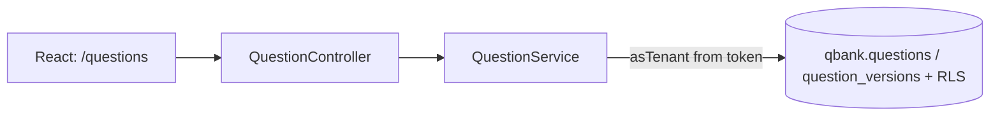

# Slice 1.2 — Question bank (MCQ + coding questions, versions, hidden test cases)

## 1. Objective
Recruiters and org admins can create, search, edit (as new versions) and archive MCQ and coding questions inside their own organization.

## 2. Architecture
New module `com.arqon.core.questionbank` in `arqon-core`, schema `qbank` (own Flyway folder `db/migration/qbank`). It depends on no other module (ArchUnit-enforced both ways). Auth/tenant come from the shared security layer.


## 3. Design decisions (ADR-0021)
Logical question + immutable versions; JSONB content; optimistic concurrency; soft archive; author vs (future) candidate views; DB trigger for immutability; new permissions QUESTION_READ / QUESTION_WRITE for ORG_ADMIN and RECRUITER only.

## 4. API
| Method | Path | Notes |
|---|---|---|
| POST | /api/v1/questions | create (version 1). 201 |
| GET | /api/v1/questions?type&difficulty&tag&search&page&size | active questions of the caller's tenant |
| GET | /api/v1/questions/{id} | current version (works for archived) |
| GET | /api/v1/questions/{id}/versions | history |
| GET | /api/v1/questions/{id}/versions/{n} | a specific version |
| PUT | /api/v1/questions/{id} | creates version n+1; body needs `expectedVersion`; 409 if stale/archived; type cannot change |
| DELETE | /api/v1/questions/{id} | archive, 204 |

Example (coding):
```json
{"type":"CODING","title":"Sum","body":"Read two ints, print the sum","difficulty":"MEDIUM","tags":["math"],
 "coding":{"languages":["JAVA","PYTHON"],"starterCode":{"JAVA":"class Main {}"},"timeLimitMs":2000,"memoryLimitMb":256,
  "testCases":[{"input":"1 2","expectedOutput":"3","hidden":false,"weight":1},{"input":"5 7","expectedOutput":"12","hidden":true,"weight":3}]}}
```
Validation errors: `400 VALIDATION_ERROR` with `details[{field,message}]` (e.g. `mcq.options`).

## 5. Run
Same as docs/SLICE-1.1b-modular-monolith.md. The new `qbank` schema is migrated automatically on startup (Flyway runs as the owner role). No `down -v` needed this time.

## 6. Verify (browser)
1. Sign in as an org admin or recruiter (create one via the Super Admin portal first) -> "Question bank" link on the portal home.
2. New question -> MCQ with 3 options -> saved; edit it -> "Save as new version" -> history shows v1, v2.
3. New question -> Coding with a hidden test case; filter the list by type/tag/search.
4. Archive a question -> disappears from the list.
5. Sign in as a recruiter of ANOTHER organization -> sees none of these questions; opening another tenant's question URL shows "not found".
Tests: `mvn test` (validator + module boundaries), `mvn verify` (QuestionBankIT: create/validate/filter/versioning/archive/tenant isolation/permissions/immutability trigger/RLS), `npm test` (17 tests).

## 7. Honest status
- Frontend: 17 tests and the production build pass here.
- Backend: syntax-only check; **not compiled or run** by me (no Maven Central access). Run `mvn -B verify` and send me any errors.
- Things most likely to need a fix on first compile/run: Hibernate JSON mapping of the record types, the native search query with optional parameters, and the Flyway/Hibernate schema validation of jsonb columns.
- Not in this slice: candidate-facing (redacted) views, SQL question type, question import/export, sharing questions across organizations, per-test-case limits, editor with Monaco (a plain textarea is used for starter code), audit events for question changes.

## 8. Interview explanation
"Questions are versioned like source code: the question row is just identity and a pointer, and every edit appends an immutable version - enforced in the entity and by a database trigger - with optimistic concurrency so two recruiters can't silently overwrite each other. Assessments will pin (question, version), so editing a question never changes an exam that's already running. Type-specific content lives in validated JSONB so new question types don't need schema changes. Hidden test cases are only exposed through author views; candidate views will be separate types so leaking them would be a compile-time mistake, not a missed if-statement. Tenant isolation is the same two-layer design as everywhere else: token-derived tenant plus Row-Level Security, with integration tests proving cross-tenant reads return 404."
