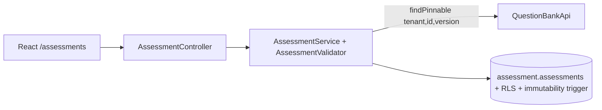

# Slice 1.3 — Assessment creation (schedule, policies, pinned questions, publish)

## 1. Objective
Recruiters and org admins build an assessment from questions in the bank: sections, pinned question versions, points, schedule, languages, integrity/scoring/visibility/recovery/identity policies; then publish it (frozen).

## 2. Architecture
New module `com.arqon.core.assessment` (schema `assessment`, Flyway folder `db/migration/assessment`). It reaches the question bank only through `QuestionBankApi` (published API, new in this slice). `Language` moved to `arqon-common` as shared vocabulary.

## 3. Decisions (ADR-0022)
Pinned versions; draft/published/archived lifecycle with DB-level freeze; validated JSONB config; revision-based optimistic concurrency; fixed vs flexible window semantics; weights exactly per present section type summing to 100; permissions ASSESSMENT_READ/WRITE/PUBLISH (ORG_ADMIN, RECRUITER).

## 4. API
| Method | Path | Notes |
|---|---|---|
| POST | /api/v1/assessments | create DRAFT (201) |
| GET | /api/v1/assessments?status&page&size | default: not archived |
| GET | /api/v1/assessments/{id} | full config + sections |
| PUT | /api/v1/assessments/{id} | DRAFT only; body needs `expectedRevision`; 409 if stale/not draft |
| POST | /api/v1/assessments/{id}/publish?expectedRevision=n | validates fully, freezes |
| POST | /api/v1/assessments/{id}/copy | new DRAFT from any assessment |
| DELETE | /api/v1/assessments/{id} | archive (204) |

Validation errors: `400 VALIDATION_ERROR` with `details[{field,message}]`, e.g. `sections[0].items[0]`, `config.scoring.weights`, `config.schedule`.

## 5. Run
Same as before. The `assessment` schema migrates automatically on startup; no DB reset needed. Frontend: Recruiter/Admin home -> "Assessments".

## 6. Verify (browser)
1. As recruiter/admin: create 2-3 questions (an MCQ and a coding one).
2. Assessments -> New: set title, schedule (try Fixed window > 3 h: rejected on save), languages, policies; "Add MCQ section" / "Add coding section" -> "Add questions" -> pick from the bank.
3. Save draft -> reopen; change something -> Save (revision increases). Open in two tabs, save in one, then save in the other -> conflict message.
4. Publish (needs weights total 100, future end date, every section with questions) -> status PUBLISHED, form becomes read-only; "Copy it into a new draft" works.
5. Another organization's user cannot see or pin these questions/assessments.
Tests: `mvn test` (validator + module boundaries), `mvn verify` (AssessmentIT: create, pin checks, cross-tenant pin rejection, fixed window rules, revisions, publish/freeze, copy, archive, tenant isolation, permissions, DB immutability trigger, RLS), `npm test` (25 tests).

## 7. Honest status
- Frontend: 25 tests and the production build pass here.
- Backend: syntax-only check by me; nothing here is compiled or run. **The earlier `mvn verify` (Slice 1.0-1.2 ITs) has not been confirmed passing yet; please run it with this zip and send the summary.** New risk areas: Hibernate JSON mapping of Instant/Map/Set fields in `config`, `@Version` + `@DynamicUpdate`, and the new triggers.
- Not in this slice: candidate-facing views, invitations, sections shuffling/randomisation, per-section time limits, question pools, SQL sections, reminders/notifications, scheduling jobs, an `AssessmentApi` for other modules (comes with invitations).

## 8. Interview explanation
"An assessment is a frozen recipe: it pins exact question versions, so editing the question bank can never change an exam that's already published. Draft editing uses optimistic concurrency, publishing re-validates everything server-side (schedule, scoring weights, language support, pinned questions) and then a database trigger enforces the freeze, so even a buggy service can't alter a live exam. Cross-module checks go through a published interface, enforced by an architecture test, which keeps the monolith extractable. Policies - integrity, scoring, visibility, recovery, identity - live in validated JSON so we can add options without schema churn, and hidden-test and answer visibility default to off."
