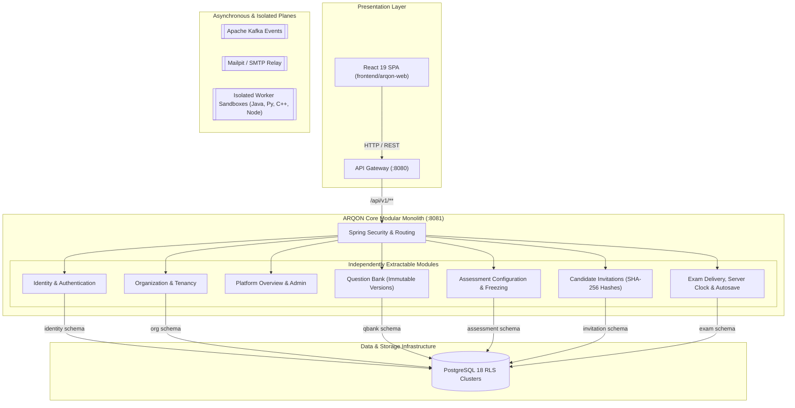

# ARQON Architecture Specification
**Platform:** ARQON (Arjun + Qualified Onboarding Network)  
**Architectural Style:** Modular Monolith (`services/arqon-core`) + API Gateway (`services/api-gateway`) + Dedicated Isolated Execution Plane  
**Reference ADR:** ADR-0001, ADR-0002, ADR-0003, ADR-0020

---

## 1. High-Level Architectural Model

ARQON delivers enterprise B2B coding examination, recruitment assessment, and proctoring workflows. The core system runs as an architecturally enforced modular monolith in `services/arqon-core` with independent schema ownership, outbox events, and strict module boundary enforcement via ArchUnit.

---

## 2. Logical Boundaries & Database Schema Ownership

Each module exclusively owns its dedicated PostgreSQL schema. Direct table access across schemas by other modules is strictly forbidden at both application and database permission levels.

| Module | Schema | Primary Tables | Cross-Module Interface |
|---|---|---|---|
| **Identity** | `identity` | `users`, `refresh_tokens`, `audit_events`, `outbox_events` | `User`, `Role`, `TokenService` |
| **Organization** | `org` | `organizations`, `outbox_events` | `OrganizationApi.existsActive(UUID)` |
| **Question Bank** | `qbank` | `questions`, `question_versions`, `outbox_events` | Question snapshot pinning by `(id, version)` |
| **Assessment** | `assessment` | `assessments`, `outbox_events` | Assessment snapshot & published immutability trigger |
| **Invitation** | `invitation` | `invitations`, `audit_events`, `outbox_events` | SHA-256 token verification, resolve endpoint |
| **Exam Delivery** | `exam` | `exam_sessions`, `exam_answers`, `audit_events`, `outbox_events` | Server-authoritative timer, OCC autosave |
| **Platform Telemetry** | Cross-schema | Aggregated read-only metrics | `PlatformOverviewController` (`rls.asSystem()`) |

---

## 3. Communication Patterns

1. **Synchronous Request-Response (REST):**
   - Public and client-facing operations flow via REST APIs with uniform error responses (`ApiError`), correlation tracking (`X-Correlation-Id`), and strict Bean Validation.
2. **Database-Level Isolation (Row-Level Security):**
   - The application connects using the unprivileged non-owner role `arqon_app` (`NOBYPASSRLS`).
   - Every tenant transaction sets `LOCAL app.tenant_id = '<uuid>'`.
   - Platform operations explicitly invoke `RlsSession.asSystem()` inside a transaction (`SET LOCAL app.system = 'on'`).
3. **Asynchronous Events (Transactional Outbox):**
   - State-changing transactions insert outbox events in their own schema's `outbox_events` table in the exact same atomic database transaction.
   - Outbox relays forward events to Apache Kafka without dual-write inconsistency risks.

---

## 4. Module Boundary Enforcement

Modular isolation is strictly validated on every build via ArchUnit (`ModuleBoundaryTest.java`):
- `identity` cannot import `organization.domain` or `organization.service`.
- `organization` cannot import `identity`.
- `questionbank` is completely independent.
- `assessment` accesses `questionbank` only through published APIs and pinned immutable versions.
- `invitation` does not reach into internal assessment logic.
- `exam` interacts only through published snapshot contracts.
