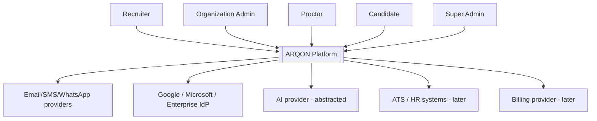
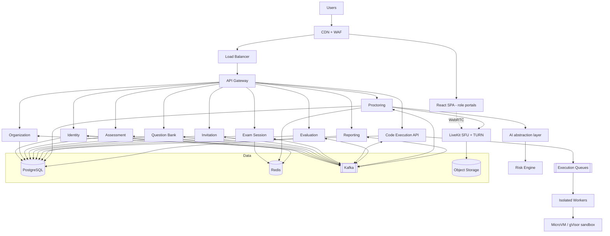

# 01 — Final architecture, C4, service & DB matrices

> **Update (ADR-0020):** the MVP runs as a modular monolith (`arqon-core`) containing the Identity, Organization, Assessment, Question Bank, Invitation, Exam Session, Evaluation and Reporting modules. Only Code Execution and Proctoring/Media remain separate services. Service boundaries below are now *module* boundaries (own package, own schema, API-only coupling).

## 1. Principles
Security > tenant isolation > data integrity > reliability > scalability > observability > maintainability > DX > cost.
Postgres = durable truth. Redis = ephemeral. Kafka = async domain events (via transactional outbox). Media plane separate from API plane. Execution plane separate from app plane.

## 2. C4 Level 1 — System Context

## 3. C4 Level 2 — Container

## 4. Service responsibility matrix
| Service | Owns | Sync APIs | Publishes | Consumes | Phase |
|---|---|---|---|---|---|
| API Gateway | routing, correlation id, IP rate limit, token forwarding | – | – | – | 1 |
| Identity | users, credentials, roles, permissions, sessions, MFA, OAuth | auth, users, roles | UserCreated, RoleChanged, LoginSucceeded/Failed | OrganizationCreated | 1 (pwd), 9 (SSO) |
| Organization | orgs/tenants, members, teams, settings, retention config | orgs, members | OrganizationCreated, MemberAdded, SettingsChanged | – | 1 |
| Assessment | assessments, sections, schedule, policies (integrity, scoring, languages, visibility, recovery) | CRUD, publish | AssessmentPublished/Updated | QuestionVersionPublished | 1 |
| Question Bank | questions, versions, options, test cases (hidden), tags | CRUD, search | QuestionVersionPublished | – | 1 |
| Invitation | invitations, tokens, expiry, onboarding state | create/resolve/revoke | InvitationCreated/Opened/Expired | AssessmentPublished | 1 |
| Exam Session | sessions, server timer, answers, code drafts, versions, recovery, device/session control | start/resume/answer/save/submit | SessionStarted/Resumed/Submitted/Terminated, AnswerSaved(milestone) | InvitationCreated, ProctorDecisionMade | 1 |
| Code Execution | jobs, state, quotas, idempotency, results | submit run/final job, status | ExecutionRequested/Completed/Failed | – | 2 |
| Evaluation | scores, per-test results, score versions | read scores | SubmissionScored, ScoreRevised | SessionSubmitted, ExecutionCompleted | 1 (MCQ), 3 |
| Proctoring | signals, evidence metadata, risk scores, review cases, decisions | event ingest, review | RiskSignalRecorded, RiskScoreUpdated, ReviewRequested, ProctorDecisionMade | SessionStarted/Terminated | 4–6 |
| Reporting | read models/projections | dashboards, exports | – | all domain events | 1 (lite), 7 |

## 5. Database ownership matrix
One Postgres cluster initially, **one schema + one DB role per service**; roles have no grants on other schemas (enforced, not conventional).
| Service | Schema | Key tables | Notes |
|---|---|---|---|
| Identity | identity | users, credentials, roles, permissions, role_permissions, user_roles, sessions, refresh_tokens, mfa_factors, audit_events | RLS on tenant-scoped |
| Organization | org | organizations, members, teams, org_settings, retention_policies | root of tenant_id |
| Assessment | assessment | assessments, sections, section_questions(ref by id+version), policies | policies versioned |
| Question Bank | qbank | questions, question_versions, options, test_cases, tags | hidden tests never returned to candidate APIs |
| Invitation | invitation | invitations, invitation_events | token stored hashed |
| Exam Session | exam | sessions, session_events, answers, code_drafts, draft_versions, submissions | optimistic locking (version, seq) |
| Code Execution | exec | jobs, job_attempts, quotas | idempotency key unique |
| Evaluation | eval | evaluations, test_results, score_versions, scoring_policies_snapshot | append-only |
| Proctoring | proctor | signals, evidence, risk_scores, review_cases, decisions | partition by time later |
| Reporting | report | read-model tables, export_jobs | may use replica |
| Every service | own schema | outbox_events, processed_events | transactional outbox + idempotent consumer |

Cross-service data: via API/events only. Referenced ids (assessment_id, question_id) are plain UUIDs without cross-schema FKs.
