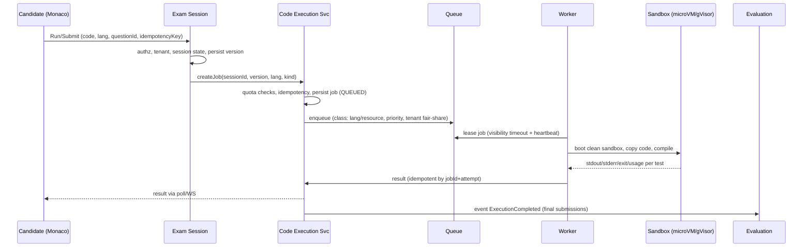
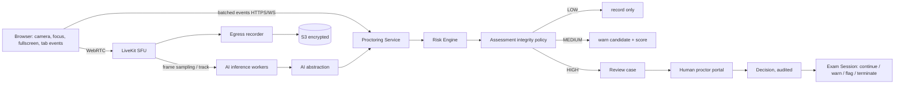

# 03 — Code execution, proctoring, AI risk

## A. Code execution architecture

**Isolation layers:** dedicated node pool (no app pods, tainted, no IAM role/IMDS blocked) → microVM/gVisor → seccomp allowlist → AppArmor → no network (default deny, no DNS) → cgroup CPU/mem/pids/file limits → read-only rootfs + tmpfs workdir with size cap → non-root, no capabilities, no privileged, no Docker socket → wall-clock + CPU timeout with hard kill → output size cap → sandbox destroyed after each job (never reused across candidates/tenants).
**Test harness:** hidden test inputs injected only inside sandbox; stdout compared by Evaluation; harness code is not user-writable.
**Scheduling:** per-candidate (e.g. 1–2 concurrent), per-tenant quota, global cap; weighted fair queueing across tenants; queue per language/resource class; autoscale on queue depth and oldest-message age (KEDA); jobs idempotent (jobId + code hash); worker crash → lease expires → retry bounded (max 2) for eligible jobs; final-submit jobs have priority over Run.
**Adding languages:** language = runtime image/rootfs + manifest (compile cmd, run cmd, limits, file name). Registered in `language-runtimes/`; no code change in the orchestration.
**Result privacy:** hidden test details only returned according to assessment visibility policy.

## B. Proctoring architecture

Candidate-facing: explicit consent screen, camera/mic permission, always-visible "recording" indicator, disconnect warning, graceful recovery. No hidden capture. Browser controls (fullscreen, copy/paste, context menu, shortcuts, devtools heuristics) are **deterrents with audit events, not guarantees**; UI says so.
Human review: on-demand queue sorted by risk; timeline of signals, evidence snapshots, clips by timestamp from S3 presigned URLs (short TTL, audited access).
Failure: AI outage ⇒ signals marked "unavailable", no penalty, no auto-termination; recording continues if SFU is up; camera disconnect follows policy (warn → grace period → flag).

## C. AI risk scoring architecture
```
Signal{type, confidence, ts, evidenceRef, source, modelVersion}
  -> normalization -> per-signal risk contribution (policy weights, confidence-gated, time-decayed, de-duplicated)
  -> aggregate score + contributing-factors list (explainable)
  -> policy thresholds -> action (record / warn / review)
```
- `AiProvider` interface (face-presence, multiple-faces, head-pose); adapters: third-party first, self-hosted later; model/version stored with each signal for audit.
- Multi-signal correlation reduces false positives (e.g. brief look away alone is low).
- Output wording is always "risk signal requires review", never "cheating".
- Bias/fairness: monitor false-positive rates by lighting/camera/skin-tone/disability proxies; always allow human override and candidate appeal path.
- Only humans can terminate for integrity reasons unless recruiter policy explicitly allows an automatic **warning**; auto-termination on AI alone is disallowed by default.
