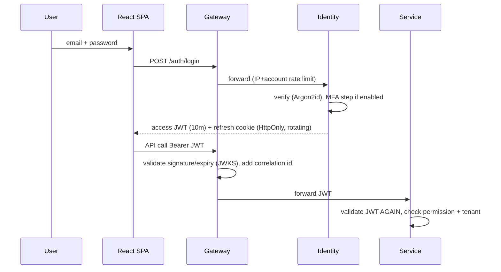

# 04 — Authentication/authorization, multi-tenancy, threat model

## Authentication flows

- JWT claims: sub, tenant_id, roles, permissions-version, session id (sid), aud, iss, exp. Asymmetric signing (RS256/EdDSA), key rotation via JWKS.
- Candidates: invitation token (random 256-bit, stored hashed, single-use for onboarding, expiry) → verify email/OTP (policy) → exam-scoped token bound to session id and assessment id; cannot call recruiter endpoints.
- MFA: TOTP + email OTP (Phase 1b/9), OAuth Google/Microsoft (Phase 9), SAML/OIDC behind `IdentityProvider` SPI.
- Refresh token reuse ⇒ revoke the whole family.

## Authorization
RBAC with permissions (`assessment:create`, `session:review`…). Roles: SUPER_ADMIN (platform, no tenant data by default; support access is audited + time-boxed), ORG_ADMIN, RECRUITER, PROCTOR, CANDIDATE. Enforced with method security (`@PreAuthorize`) in **every service**; gateway only coarse-filters. Resource-level checks (e.g. recruiter owns/has team access to the assessment) in service layer. Frontend guards are UX only.

## Multi-tenancy architecture
1. Tenant id derived **only** from validated token (and, for candidates, from the invitation record), never from request body/params/headers.
2. `TenantContext` populated by a security filter; propagated to async/event handlers via event `tenantId`.
3. Every tenant table has `tenant_id NOT NULL`, composite indexes lead with `tenant_id`.
4. Defence in depth: Hibernate `@Filter` + Postgres RLS (`SET LOCAL app.tenant_id`) with a non-superuser app role that cannot bypass RLS.
5. Redis keys, S3 prefixes (`tenant/{id}/…`), Kafka headers, logs, metrics all carry tenant id.
6. Per-tenant quotas (rate, execution, storage, exports).
7. Enterprise tier: routing by tenant → dedicated DB / bucket (KMS key per tenant) / execution pool. Needs a `TenantRouting` abstraction from day one (datasource resolver) even if everything points to one DB initially.
8. Automated cross-tenant leakage tests are mandatory in CI for every endpoint.

## Threat model (STRIDE-oriented summary)
| # | Threat | Asset | Mitigations |
|---|---|---|---|
| T1 | Sandbox escape / host compromise | Execution nodes | microVM/gVisor, seccomp, no network, dedicated nodes, no creds on node, ephemeral sandboxes, kernel patching, specialised pen-test |
| T2 | Resource exhaustion by code (fork bomb, huge output, crypto-mining) | Exec capacity | cgroups, pids limit, timeouts, output caps, quotas, fair-share |
| T3 | Cross-tenant data access (IDOR) | All data | token-derived tenant, RLS, resource checks, automated tests |
| T4 | Credential stuffing / brute force | Accounts | Argon2id, rate limits, MFA, lockout with backoff, breached-password check |
| T5 | Token theft / replay | Sessions | short JWT, HttpOnly refresh, rotation, reuse detection, TLS/HSTS |
| T6 | Invitation link sharing / candidate impersonation | Integrity | hashed single-use tokens, expiry, OTP/ID/selfie by policy, device/session binding, audit |
| T7 | Exam tampering (client timer, forged answers, stale overwrite) | Integrity | server timer, version/seq checks, server-side validation |
| T8 | Hidden test case leakage | IP | never in candidate DTOs, visibility policy, restricted DB role |
| T9 | Evidence/video exposure | Privacy | private S3, KMS, presigned short TTL, access audit, retention |
| T10 | AI false positives harming candidates | Fairness | human-in-loop, explainability, no auto-termination, appeal |
| T11 | Event forgery / replay in Kafka | Integrity | ACLs, mTLS/SASL, idempotent consumers, schema validation |
| T12 | Injection (SQL/XSS/SSTI) | App | parameterized queries, validation, output encoding, CSP |
| T13 | DoS on mass start / WS flood | Availability | WAF, rate limits, WS message/size limits, admission control, autoscaling |
| T14 | Insider/admin abuse | All | least privilege, audited super-admin access, break-glass |
| T15 | Supply chain (deps, images) | Platform | SCA, image scanning, SBOM, pinned digests, signed images |
| T16 | Secrets leakage | Platform | secrets manager, no secrets in git/logs, rotation |
| T17 | SSRF via integrations/webhooks | Internal net | egress allowlist, URL validation, no private ranges |
| T18 | Recording consent/privacy non-compliance | Legal | explicit consent, retention policies, DPA, region control |
