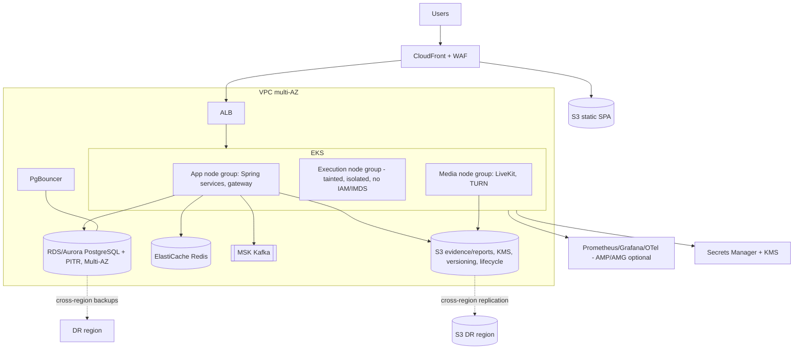

# 06 — Local infrastructure, future AWS, risks & trade-offs

## Local development (Docker Compose, no Kubernetes)
See infra/docker/docker-compose.yml: PostgreSQL 16, Redis 7, Kafka (KRaft), MinIO (S3), Mailpit (SMTP), Prometheus, Grafana, OTel Collector (later). LiveKit added in Phase 4. Execution sandbox runs locally only via rootless/gVisor and is **not production-grade**.
Run: `cp infra/docker/.env.example infra/docker/.env && docker compose -f infra/docker/docker-compose.yml --env-file infra/docker/.env up -d`
Verify: `docker compose ps` all healthy; Grafana http://localhost:3000; MinIO console http://localhost:9001; Mailpit http://localhost:8025.

## Future AWS architecture

Terraform for all infra; GitHub Actions CI/CD with image signing; HPA for services, KEDA for execution workers (queue depth/age); PodDisruptionBudgets; multi-AZ. DR: RPO ≤15 min (PITR + WAL), RTO ≤1 h (IaC rebuild + restore + runbooks, quarterly drills). Availability target 99.9%.

## Risks and trade-offs
| Risk / trade-off | Impact | Mitigation |
|---|---|---|
| 11 services = high ops/complexity for small team | slow delivery | deploy-by-phase, strict boundaries, shared starters, good CI |
| Firecracker needs bare-metal/special nodes | cost, complexity | gVisor bridge; node pools sized by queue |
| Shared DB tenancy | noisy neighbour, leak risk | RLS, quotas, indexes, enterprise dedicated option |
| 5k concurrent mass start | DB/connection spike | caching config, PgBouncer, admission control, jittered retry, spike tests |
| Video/AI cost at scale | margin | sample frames, on-demand review, lifecycle, self-host AI later |
| Browser controls bypassable | integrity claims | honest UX/marketing, multi-signal + human review |
| AI false positives, privacy law (DPDP/GDPR) | legal/reputation | consent, human-in-loop, retention, DPA, legal review early |
| Kafka eventual consistency in reporting | stale dashboards | acceptable by design; show "as of" time |
| Outbox poller latency/load | delay | tuned polling, SKIP LOCKED, later CDC |
| Custom identity security burden | vulns | proven libs, abstraction, consider Keycloak |
| Scope vs solo/small-team capacity | burnout | slice discipline, MVP first |
