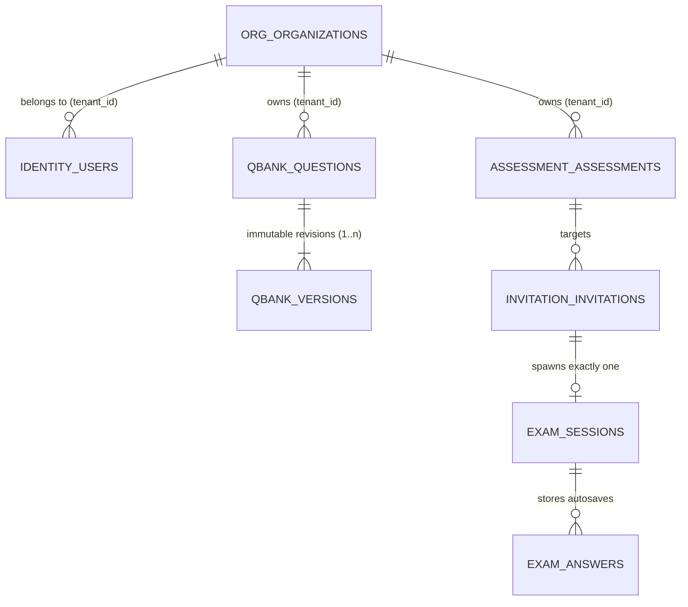

# ARQON Data Model & Schema Ownership
**Database:** PostgreSQL 18.6+  
**Connection Modes:** Owner Role (`arqon` for Flyway migrations), Runtime Role (`arqon_app` with `NOBYPASSRLS` for application operations).

---

## 1. Schema Matrices & Ownership

---

## 2. Table Specifications by Schema

### A. Schema: `identity`
- **`users`**:
  - `id` (UUID PK): Unique user identifier.
  - `tenant_id` (UUID, NULL for `SUPER_ADMIN`, mandatory for tenant users).
  - `email` (VARCHAR(320) NOT NULL, unique index on `lower(email)`).
  - `password_hash` (VARCHAR(255) NOT NULL, Argon2id).
  - `role` (VARCHAR(30) NOT NULL: `SUPER_ADMIN`, `ORG_ADMIN`, `RECRUITER`, `PROCTOR`, `CANDIDATE`).
  - `status` (VARCHAR(20) NOT NULL: `ACTIVE`, `DISABLED`).
  - `failed_attempts` (INT NOT NULL DEFAULT 0).
  - `locked_until` (TIMESTAMPTZ).
  - `last_login_at` (TIMESTAMPTZ).
  - RLS Policy: `tenant_isolation` enforces `tenant_id = current_setting('app.tenant_id')` or `app.system = 'on'`.
- **`refresh_tokens`**:
  - Token hash (SHA-256), session family, rotated/revoked timestamps, RLS protected.
- **`audit_events`**:
  - Immutable action log, actor ID, correlation ID, IP, JSONB metadata.

### B. Schema: `org`
- **`organizations`**:
  - `id` (UUID PK, serves as the global `tenant_id`).
  - `name` (VARCHAR(200) NOT NULL).
  - `slug` (VARCHAR(50) NOT NULL, UNIQUE).
  - `status` (VARCHAR(20) NOT NULL: `ACTIVE`, `SUSPENDED`).
  - `created_at`, `created_by`.
  - RLS Policy: `current_setting('app.system') = 'on' OR id = current_setting('app.tenant_id')::uuid`.

### C. Schema: `qbank`
- **`questions`**: Logical question entity (`id`, `tenant_id`, `type`, `title`, `difficulty`, `tags`, `current_version`, `status`).
- **`question_versions`**: Immutable versions (`question_id`, `version`, `title`, `body`, `content` [MCQ options or coding test cases including hidden cases]).
  - Database Trigger: `trg_question_versions_immutable` aborts any UPDATE or DELETE.

### D. Schema: `assessment`
- **`assessments`**:
  - `id`, `tenant_id`, `title`, `status` (`DRAFT`, `PUBLISHED`, `ARCHIVED`), `config` (JSONB), `sections` (JSONB with pinned question IDs and versions).
  - Database Trigger: `trg_assessments_protect` forbids mutations to title, description, config, or sections once `status = 'PUBLISHED'`.
  - Database Trigger: `trg_assessments_no_delete` forbids hard DELETE operations (soft archive only).

### E. Schema: `invitation`
- **`invitations`**:
  - `id`, `tenant_id`, `assessment_id`, `candidate_email`, `token_hash` (SHA-256 only; raw token never stored), `status` (`PENDING`, `OPENED`, `REVOKED`), `email_status`, `expires_at`.
  - Unique Constraint: `(tenant_id, assessment_id, candidate_email) WHERE status <> 'REVOKED'`.

### F. Schema: `exam`
- **`exam_sessions`**:
  - `id`, `tenant_id`, `invitation_id` (UNIQUE), `assessment_id`, `candidate_email`, `token_hash`, `status` (`IN_PROGRESS`, `SUBMITTED`, `AUTO_SUBMITTED`), `started_at`, `deadline_at`, `submitted_at`, `snapshot` (JSONB), `result` (JSONB).
  - Database Trigger: `trg_exam_sessions_protect` enforces immutability once submitted.
- **`exam_answers`**:
  - `(session_id, question_id)` composite PK, `answer` (JSONB), `saved_at`.
  - Database Trigger: `trg_exam_answers_protect` blocks answers from being created or altered after session deadline/submission.

---

## 3. Migration Verification

All migrations are maintained under `services/arqon-core/src/main/resources/db/migration/<schema>` and executed via Flyway during startup:
1. `org`: `V1__organizations_outbox_rls.sql`
2. `identity`: `V1__outbox_and_processed_events.sql`, `V2__users_sessions_audit_rls.sql`
3. `qbank`: `V1__questions.sql`
4. `assessment`: `V1__assessments.sql`
5. `invitation`: `V1__invitations.sql`
6. `exam`: `V1__exam_sessions.sql`
