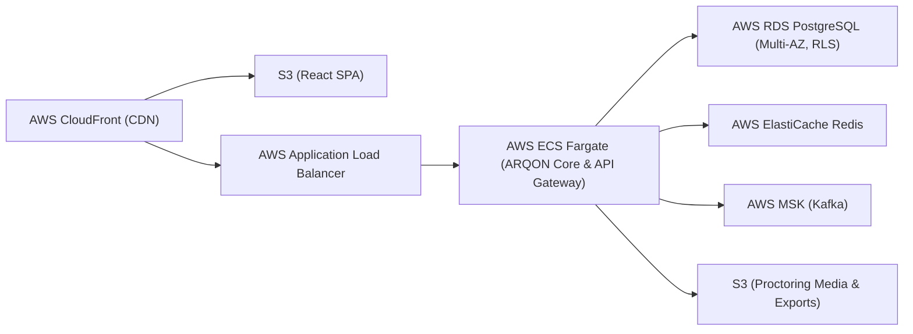

# ARQON Deployment Guide & Production Operational Standards

---

## 1. Local Development Deployment

### Prerequisites
- JDK 21 LTS (Oracle or Eclipse Temurin)
- Node.js 20+ & npm
- PostgreSQL 18.6+ running on port 5433 (or standard port with custom configuration)

### Configuration Variables
```bash
# Database Connectivity
export DB_HOST="localhost"
export DB_PORT="5433"
export DB_NAME="arqon"
export DB_APP_USERNAME="arqon_app"
export DB_APP_PASSWORD="change_me_local_app"
export DB_MIGRATION_USERNAME="arqon"
export DB_MIGRATION_PASSWORD="change_me_local"

# Initial Super Admin Provisioning
export ARQON_BOOTSTRAP_ADMIN_NAME="Arjun Shinde"
export ARQON_BOOTSTRAP_ADMIN_EMAIL="arjunnshinde9@gmail.com"
export ARQON_BOOTSTRAP_ADMIN_PASSWORD="YourSecurePasswordHere123!"

# Frontend Dev Server Proxy Target
export API_TARGET="http://localhost:8081"
```

### Running the System
```powershell
# 1. Build and install Java modules
mvn clean install -DskipTests=true

# 2. Run the core backend
java -jar services/arqon-core/target/arqon-core-0.1.0-SNAPSHOT.jar

# 3. In another terminal, run the frontend
cd frontend/arqon-web
npm install
npm run dev
```

---

## 2. Production AWS Deployment Direction



### AWS Production Architecture Components
1. **Frontend:** React SPA bundled via Vite, hosted on Amazon S3 and distributed via Amazon CloudFront with TLS 1.3 and WAF rate-limiting.
2. **Container Orchestration:** AWS ECS Fargate running microservice task definitions with non-root IAM task execution roles.
3. **Database:** AWS RDS PostgreSQL Multi-AZ with automated automated snapshot backups, Point-In-Time Recovery (PITR), and separate `arqon` (migration) and `arqon_app` (runtime) roles.
4. **Secrets Management:** AWS Secrets Manager injects database credentials and RSA signing keys into ECS tasks during initialization.
