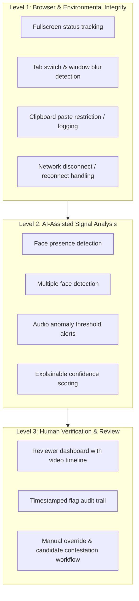

# ARQON Proctoring Architecture & Integrity Policy

---

## 1. Proctoring Tiers & Design Principles

ARQON implements a progressive, configurable 3-tier proctoring architecture designed to balance examination integrity with privacy, transparency, and network resilience.

---

## 2. Integrity Signals & Thresholds

| Signal | Source | Detection Mechanism | Consequence |
|---|---|---|---|
| **Tab Switch / Focus Loss** | Browser Events | `visibilitychange`, `window.onblur` | Candidate warning banner; timestamped event logged in exam audit trail. Configurable threshold (e.g. 3 warnings before proctor flag). |
| **Fullscreen Exit** | HTML5 Fullscreen API | `fullscreenchange` | Re-entry modal prompt; time outside fullscreen recorded. |
| **Paste Event** | DOM Event Listener | `clipboardData` interception | Denied or permitted with character count and origin audit log. |
| **Face Disappearance** | WebRTC MediaStream | Client-side lightweight vision model (TensorFlow.js / MediaPipe) | Flag recorded after 10 continuous seconds of absence. |
| **Multiple Faces** | WebRTC MediaStream | Client-side face detection | Proctor review flag with video timestamp bookmark. |

---

## 3. Privacy, Data Minimization & Retention

1. **Explicit Consent & System Check:**
   - Candidates are informed of all proctoring checks prior to starting the assessment.
   - Device compatibility checks verify camera, microphone, and network bandwidth before entering the timed exam.
2. **Human-in-the-Loop Principle (ADR-0011):**
   - AI flags are indicators, never automated disqualifications.
   - All high-severity flags require human review before assessment invalidation.
3. **Evidence Storage & Retention:**
   - Media recordings and audit events are tied to the tenant boundary and stored in S3/MinIO with short-lived presigned URLs.
   - Configurable retention policies automatically delete proctoring media according to GDPR and organizational data policies (default: 90 days after result publication).
